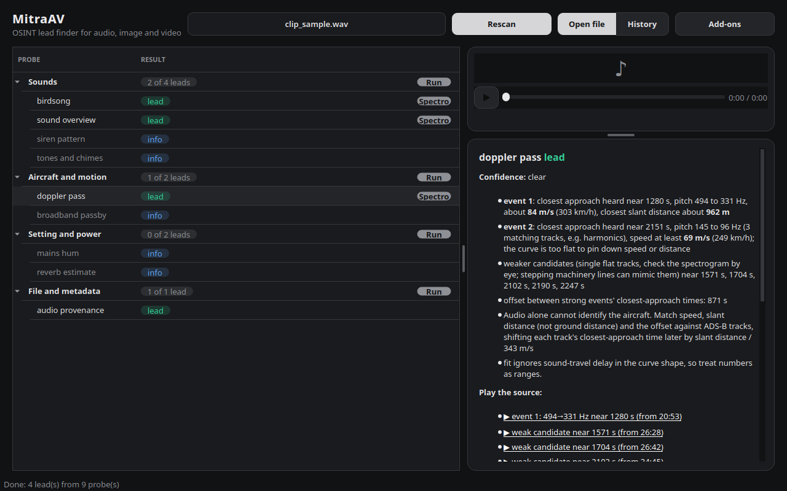
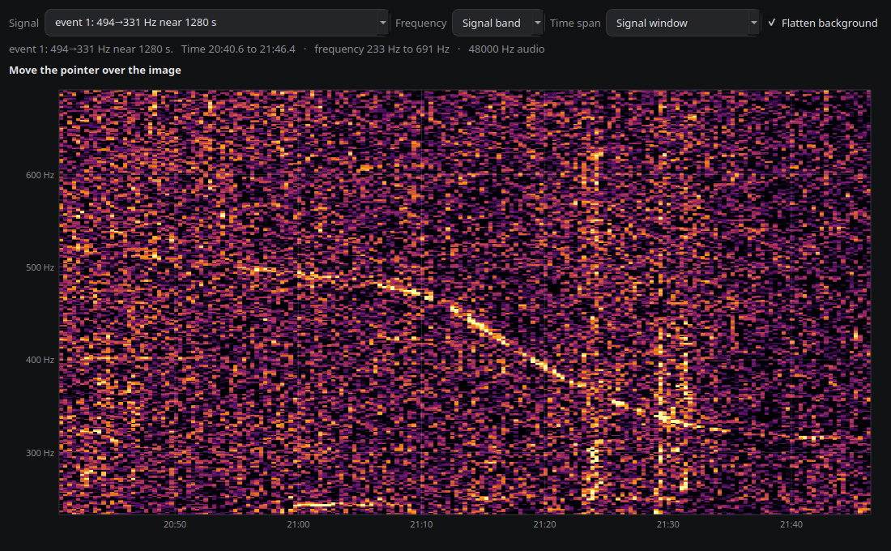

# MitraAV

A local, first-step OSINT lead finder. Drop an image, audio or video file into the app and press **Start scan**. Many cheap
"probes" each test whether an identifying signal is present, say plainly what they found (or that
they found nothing), and **points you to your next step**.

It is triage: it measures signals and names what it can, offline. It is **not** a solver, it makes
**no network calls during a scan**, and it is not for identifying private individuals (no face
recognition, no plate reading, no phone numbers or e-mail addresses echoed back).

> **Work in progress.** MitraAV is under active development. Probes, results, wording and the
> interface will change as the project develops, and features may be reworked or removed where they
> don't prove useful. Expect rough edges, and treat every result as a lead, never a conclusion.
> Feedback and bug reports are very welcome.

### Examples

**An audio fly-by (synthetic).** Results are grouped by what they tell you; the Doppler probe measures
speed, closest distance and the time offset between events.



**The identified signal**, with labelled axes and a live time and frequency readout.



## Status

Alpha. Developed on Linux; the test suite runs on Python 3.11, 3.12 and 3.13 in CI. Windows and macOS
are untested. Probes are tuned on a small set of real recordings and photos, so expect false positives
and misses: every result is a lead, never a conclusion, and the app says so (confidence,
"inconclusive" for busy audio, "very low" flags).

## Install

```bash
python -m venv .venv && source .venv/bin/activate      # Python 3.11 or newer
pip install .                                          # core: audio, video and image probes
mitraav-setup                                          # installs the small add-ons, shows what is missing
```

Optional pieces are **add-ons**. Install them from the **Add-ons** button in the app or with
`mitraav-setup --install <name>`. Nothing is installed unless you ask.

| Add-on | Adds | Download |
|---|---|---|
| `sounds` | names sounds: trains, horns, bells, sirens, aircraft, animals, weather | about 25 MB |
| `scene` | names the kind of place in a picture, as quiet context | about 45 MB |
| `birds` | bird ID by sound, plus a general region and season | about 150 MB |
| `nature` | species candidates for photos of plants, animals, fungi (BioCLIP) | about 1.7 GB, off by default |

System tools come from your package manager (the app and `mitraav-setup --list` say what is missing):
`ffmpeg` (video and non-WAV audio), `exiftool` (edit traces in images), `tesseract-ocr` (text in
images; add `tesseract-ocr-<lang>` packs for other languages).

## Use

```bash
mitraav [file]                  # the app (drop a file on it, press Start scan; a file passed here scans at once)
mitraav-scan file [--json]      # the same probes from the command line
```

Results are grouped. **Confidence** says how clearly a signal is present (clear, likely, faint);
Inactive probes (nothing found, not run) sit greyed at the bottom of their group. "Context" rows
(scene type, reverse-search helper) only report what you could see yourself and are folded away.
Rows that point at a signal in a recording have a small action button: **Spectro** opens the spectrogram on that
finding's signal, **Image** shows the picture full size, with any text lines outlined (the text itself is withheld for numbers) and **Map** opens GPS coordinates in OpenStreetMap. History (next to Open file) lists earlier scans.

The file you dropped stays in view: images show a thumbnail (click to enlarge), videos show a frame
and a small player, and audio gets a player, all above the details. Findings that point at a moment
in the recording offer "▶ play from here" links, so you can listen to what a probe flagged.

## What it looks for

- **Sounds:** what the sounds are, bird species, a sound overview, bird species, **tones and chimes** (church bell pitch, telephone and alert tones, any other stable pitch measured and named), siren patterns.
- **Aircraft and motion:** Doppler pass-bys (speed, closest distance, offsets between events) and broadband jet pass-bys.
- **Setting and power:** 50/60 Hz mains hum, lighting flicker in video, reverberation.
- **Text and visuals:** language, script, calling codes, web domains, currencies and units in image text; species for photos; scene type; reverse-search helper.
- **File and metadata:** EXIF and video tags, codec and platform fingerprints, JPEG history, audio history (lossy codecs, silence, edits).

Everything is a lead, worded as "consistent with". Numbers are ranges, not facts. Matching against
external datasets (flight tracks, grid frequency logs, incident catalogues) is deliberately left to
the tools the results point to.

## Privacy

Scans run on your machine and make no network calls. The only network use is installing an add-on
(you click Install, and the dialog lists exactly what will be downloaded). The History list stores
file paths, names and counts in your user data folder, never results; clear it from the History dialog.
Follow-up links open third-party sites in your browser; MitraAV never uploads your file anywhere.

## Limits worth knowing

- Sound probes are marked **inconclusive** when speech, music or a siren fills the recording, because
  they cannot be trusted there. Quiet bird calls under speech are not heard.
- Species and scene labels come from general models: they name things a person could also see or hear,
  and they are often wrong at the margins. Cultivated plants grow far outside their native ranges.
- Bird range results are a general region lead from a coarse model, not a location.
- Doppler numbers are ranges from a simplified model (no sound-travel delay in the curve shape).

## Credits and licences

MitraAV is released under the [MIT License](LICENSE). Third-party models, data and tools it can
download or call have their own terms: see [NOTICE.md](NOTICE.md). In particular the BirdNET models
(an optional add-on) are published for non-commercial use.

## Development

```bash
pip install -e ".[dev]"        # add ,sound ,birds as needed
pytest -q
```

See [docs/ARCHITECTURE.md](docs/ARCHITECTURE.md) for the architecture, design rules and how to add a probe.
